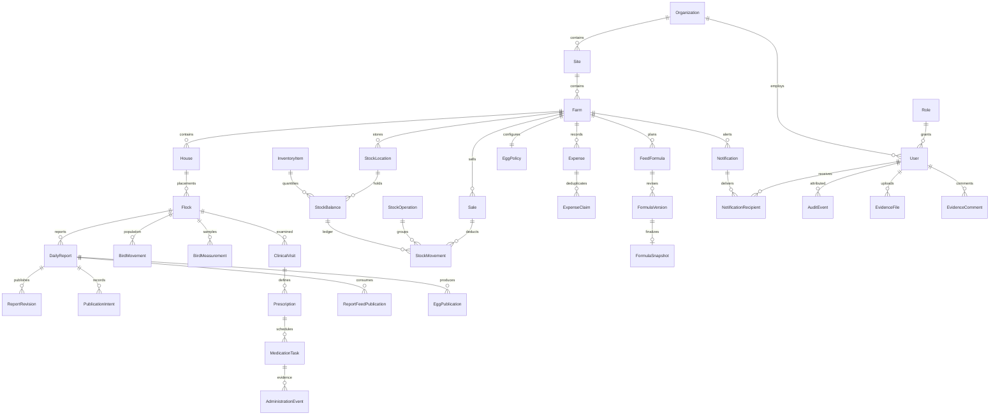

# Logical data model

Mongoose definitions in `server/src/modules/*/models.js` are authoritative. This diagram shows aggregate ownership and evidence relationships; every operational aggregate also carries organization and derived hierarchy scope.

Evidence files/comments reference a supported parent type plus ID (report, visit, expense or medical alert). Authorization always resolves that parent. A submitted report seals linked images. Private file bytes live outside MongoDB and static SPA storage.

Important invariants/indexes:

- Logical report is unique per organization/flock/business date; revisions are unique per report/number. Publication keys prevent duplicated egg/feed effects.
- One active flock occupies a house. Hierarchy ancestors are derived on the server and cannot be reparented by request fields.
- Population and stock movements, submitted report revisions, finalized formula snapshots and administration events form append-only evidence; corrections add linked effects/versions.
- Stock balances are unique per organization/item/location; movement source keys and durable request hashes protect retries. Integer thousandths represent canonical stock quantities. Currency uses Decimal128 and explicit rounding.
- Medication occurrences have stable prescription/item/due identities; one effective event pointer can be superseded with attributed correction evidence. Prescriber identity remains the original creator.
- Notification condition keys/episodes deduplicate worker scans; recipient records independently retain seen/acknowledgement state. Source resolution clears automated reminders.
- Audit indexes include organization/time, actor/time, target/time and farm/time. Read projection is narrower than stored redacted service evidence.
- Sessions persist in MongoDB with expiry; application backup intentionally excludes them. `SecurityGuard` serializes critical business/access writes, and migration records prevent repeated initialization.

API request validators and permission metadata can be inspected in [OpenAPI](openapi.json), regenerated with `npm run docs:api`. It documents request shapes and response media/errors; individual permission-aware response fields and state transitions remain documented in the phase implementation logs.
